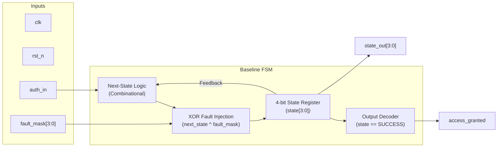
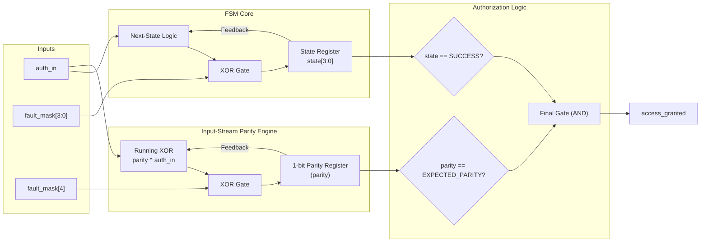
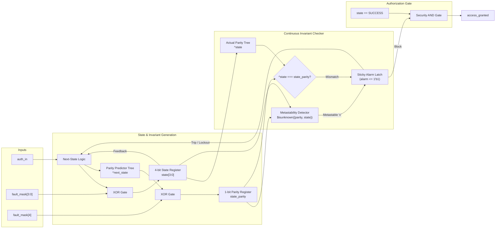
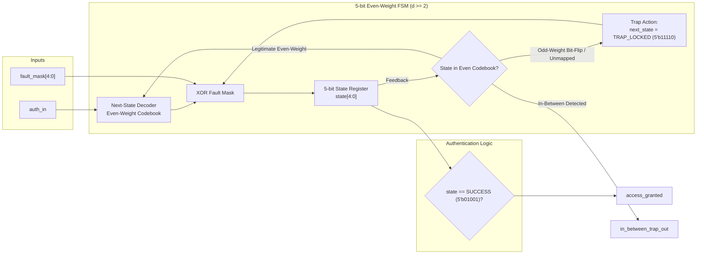
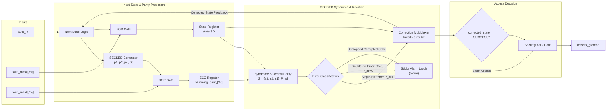
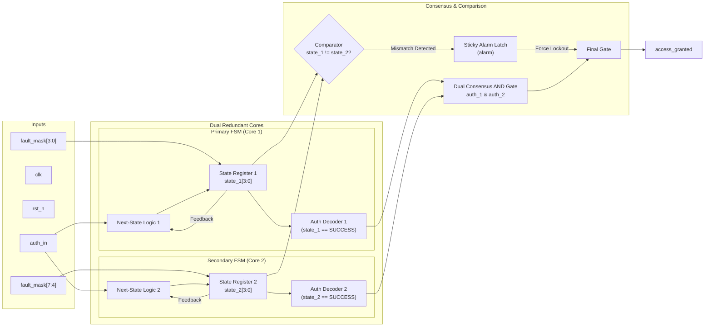
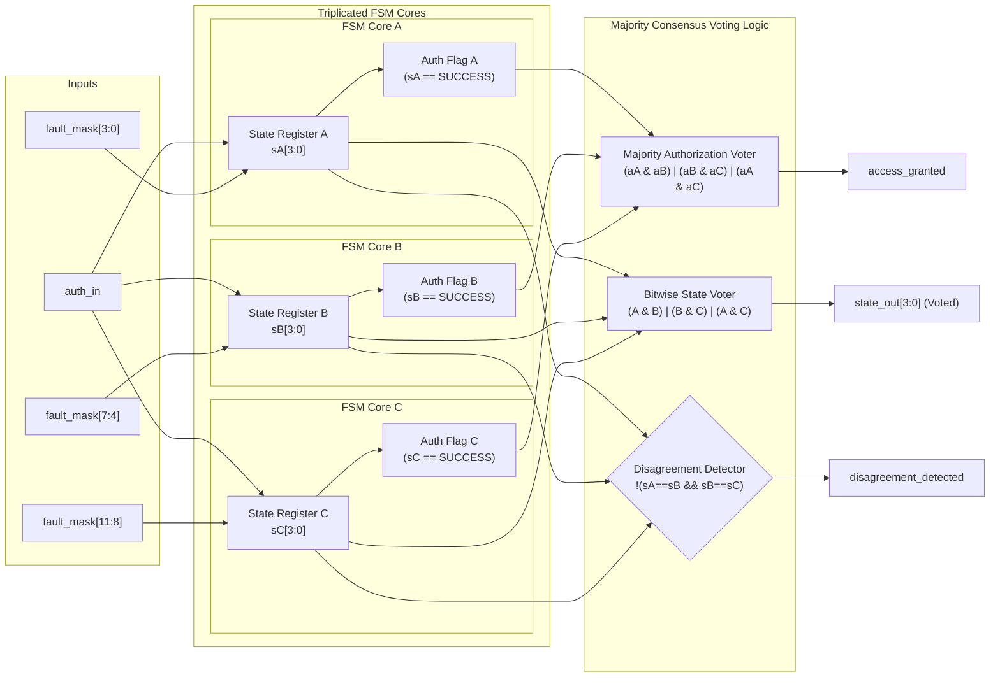
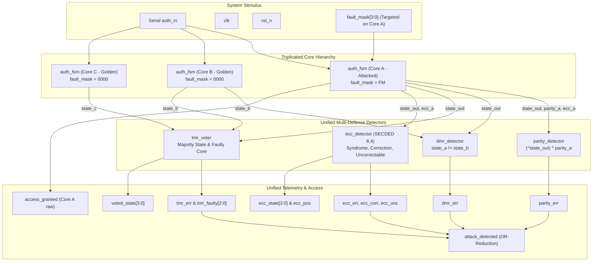

# Fault-Resilient Secure Finite State Machine (FSM)

[](https://en.wikipedia.org/wiki/Verilog)
[](http://iverilog.icarus.com/)
[](http://gtkwave.sourceforge.net/)
[]()

A hardware security research and implementation project evaluating physical **Fault Injection Attacks (FIA)** (such as localized laser strikes and clock/voltage glitching) on serial authentication Finite State Machines, developed for **CS203: Digital Logic Design**.

---

## 📌 Project Overview

Authentication FSMs controlling secure hardware access are vulnerable to physical transient state register corruption ($S_{\text{injected}} = S_{\text{raw}} \oplus M_{\text{fault}}$), enabling unauthorized bypass (e.g. flipping `LOCKED` directly into `SUCCESS`). 

This repository implements, simulates, and benchmarks **six hardware countermeasure architectures** against an unprotected baseline, ranging from lightweight parity checks to active Extended Hamming SECDED rectification and Triple Modular Redundancy (TMR).

---

## 🏗️ Hardware Countermeasures Implemented

| Architecture | Folder | Mechanism | Primary Asset Protected | Hardware Overhead | Security Philosophy |
| :--- | :--- | :--- | :--- | :---: | :--- |
| **Baseline FSM** | [`FSM/`](./FSM) | Constant-time 4-cycle sequence detector (`1010`) | None (Reference) | 4 FFs | Vulnerable (0% FDR) |
| **Solution 1** | [`Solution 1.../`](./Solution%201%20-%20Simple%201%20bit%20parity%20check) | Input-Stream Running XOR Parity Accumulator | Input Serial Line | 5 FFs | Wire Integrity |
| **Solution 2** | [`Solution 2.../`](./Solution%202%20-%20Parity%20Protected%20State%20Register) | Self-Checking Invariant Parity (`^state == parity`) + Sticky Alarm | State Flip-Flops | 6 FFs | **Fail-Secure** (Minimal Area) |
| **Solution 3** | [`Solution 3.../`](./Solution%203%20-%20Increased%20Hamming%20Distance) | Even-Weight 5-bit State Codebook ($d_{\min} \ge 2$) + Trap States | State Space Boundary | 5 FFs | Fail-Secure (Trapped) |
| **Solution 4** | [`Solution 4.../`](./Solution%204%20-%20Extended%20Hamming%20SECDED) | Extended Hamming $(8, 4)$ SECDED on State Register | State Integrity | 9 FFs | **Active Rectification** (Freddin) |
| **Solution 5** | [`Solution 5.../`](./Solution%205%20-%20Dual%20Modular%20Redundancy) | Dual Modular Redundancy (DMR) + Dual Consensus AND Gate | Single-Core Faults | 9 FFs | **Strict Dual Consensus** |
| **Solution 6** | [`Solution 6.../`](./Solution%206%20-%20Triple%20Modular%20Redundancy) | Triple Modular Redundancy (TMR) + Majority Voter ($AB+BC+AC$) | Single-Core Faults | 12 FFs | **High Availability Masking** |
| **Unified Top**| [`Combined Testbench/`](./Combined%20Testbench) | Multi-Defense Benchmark Harness (`secure_fsm_top`) | Entire System | $\sim 19$ FFs | Diagnostic Benchmark |

---

## 📐 Architecture Block Diagrams

### 1. Baseline Architecture (Unprotected FSM)


---

### 2. Solution 1: Input-Stream Running Parity Accumulator


---

### 3. Solution 2: Self-Checking State-Register Invariant Parity Protection


---

### 4. Solution 3: Increased Minimum Hamming Distance ($d_{\min} \ge 2$) & Trap States


---

### 5. Solution 4: Extended Hamming SECDED (8,4) On-the-Fly Rectification


---

### 6. Solution 5: Dual Modular Redundancy (DMR / Dual Consensus)


---

### 7. Solution 6: Triple Modular Redundancy (TMR / Majority Voting)


---

### 8. Combined Top-Level Architecture (`secure_fsm_top`)


---

## 📊 Benchmark & Experimental Results

The unified verification suite evaluated **202 distinct fault injections** across all 9 operating states (`IDLE`, `GOT_1`, `GOT_10`, `GOT_101`, `SUCCESS`, `ERR_1`, `ERR_2`, `ERR_3`, `LOCKED`):

| Countermeasure | Faults Injected | Fault Detection Rate (FDR) | Fault Masking Rate (FMR) | Attack Success Rate (ASR) | Key Finding |
| :--- | :---: | :---: | :---: | :---: | :--- |
| **Baseline FSM** | 202 | 0.0% (0 / 202) | 0.0% | **14.85% Bypass** | Raw bypass occurs whenever bit-flips hit `0111`. |
| **Parity Check** | 202 | **51.49%** (104 / 202) | N/A | **48.51% Undetected** | **Blind to even-weight masks** (`0011`, `1111`). |
| **DMR Consensus** | 202 | **100.0%** (202 / 202) | N/A | **0.0% Bypass** | 100% deauth lock on any single-core divergence. |
| **TMR Voter** | 202 | **100.0%** (202 / 202) | **100.0%** (202 / 202) | **0.0% Bypass** | 100% transparent on-the-fly masking of single-core errors. |
| **SECDED (8,4)** | 202 | **100.0%** (202 / 202) | **100.0% of 1-bit** (52/52)| **0.0% Bypass** | Dynamically rectifies single-bit faults; locks out multi-bit attacks. |

> **Comprehensive Reports:** Full datasets and graphical dashboards are available in [`Combined Testbench/CS203_Fault_Resilience_Benchmark_Report.xlsx`](./Combined%20Testbench/CS203_Fault_Resilience_Benchmark_Report.xlsx) and [`Combined Testbench/attack_results_exhaustive.csv`](./Combined%20Testbench/attack_results_exhaustive.csv).

---

## 📁 Repository Structure

```text
DLD Project/
├── README.md                                   # Project documentation & architecture diagrams
├── CS203_Fault_Resilience_Benchmark_Report.xlsx# Multi-sheet Excel benchmark workbook
│
├── Combined Testbench/                         # Unified multi-defense top module & testbench
│   ├── design.sv                               # secure_fsm_top RTL wrapper
│   ├── testbench.sv                            # 202-injection verification suite (TC-01 to TC-05)
│   ├── attack_results_exhaustive.csv           # Tabular export of all 202 fault outcomes
│   ├── detect.vcd                              # GTKWave simulation trace dump
│   ├── logs.txt                                # Raw compiler & simulator output
│   └── run_sim.ps1 / run_sim.bat               # One-click automated simulation scripts
│
├── FSM/                                        # Baseline unprotected 4-bit FSM
├── Solution 1 - Simple 1 bit parity check/     # Input-stream XOR accumulator
├── Solution 2 - Parity Protected State Register/# Invariant state parity & sticky alarm
├── Solution 3 - Increased Hamming Distance/    # Even-weight d_min >= 2 encoding
├── Solution 4 - Extended Hamming SECDED/       # SECDED (8,4) dynamic rectification FSM
├── Solution 5 - Dual Modular Redundancy/       # Dual consensus FSM with comparator
└── Solution 6 - Triple Modular Redundancy/     # Triplicated FSM with majority voter
```

---

## 🚀 Quickstart & Simulation

### Prerequisites
* [Icarus Verilog](http://iverilog.icarus.com/) (`iverilog`, `vvp`)
* [GTKWave](http://gtkwave.sourceforge.net/) (for `.vcd` waveform inspection)

### Run the Unified Benchmark Suite
```powershell
cd "Combined Testbench"
.\run_sim.ps1
# or on CMD: run_sim.bat
```

### Run Any Discrete Standalone Solution
```powershell
# Example: Run Solution 4 (Extended Hamming SECDED)
cd "Solution 4 - Extended Hamming SECDED"
.\run_sim.ps1

# View waveforms in GTKWave
gtkwave fsm_simulation.vcd
```

---

## 👥 Team & Individual Contributions (CS203)

* **Instructor:** Dr. Geeta — *Department of Computer Science & Engineering*
* **Team Members & Responsibilities:**
  * **Freddin (2025CSB1416) [Lead]:**
    * Designed and implemented **Solutions 1 through 4** in Verilog RTL and C++:
      * Solution 1: Input-Stream Running Parity Accumulator
      * Solution 2: Parity Protected State Register with Sticky Alarm
      * Solution 3: Increased Hamming Distance ($d_{\min} \ge 2$) Even-Weight State Encoding
      * Solution 4: Extended Hamming $(8, 4)$ SECDED with Dynamic Error Rectification
  * **Uttkarsh Goyal (2025CSB1394):**
    * Designed and implemented **Solutions 5 and 6** in Verilog RTL and C++:
      * Solution 5: Dual Modular Redundancy (DMR) with Fail-Secure Comparator
      * Solution 6: Triple Modular Redundancy (TMR) with Majority Voting Logic
  * **Tanmay Kumar Jayant (2025CSB1263):**
    * Baseline FSM architecture and state transition pipeline.
    * Designed the top-level integration wrapper [`Combined Testbench/design.sv`](./Combined%20Testbench/design.sv) (`secure_fsm_top`) orchestrating all countermeasure modules.
  * **Ayush Awasthi (2025CSB1311):**
    * Developed the 202-fault exhaustive testbench suite in [`Combined Testbench/testbench.sv`](./Combined%20Testbench/testbench.sv).
    * Executed the **Attack Analysis** (evaluating FDR, FMR, and ASR across all 9 operating states).
    * Co-authored the multi-sheet benchmark Excel workbook (`CS203_Fault_Resilience_Benchmark_Report.xlsx`).
  * **Dane Prince Daniel (2025CSB1548):**
    * Conducted the **Time and Hardware Area Analysis** (evaluating flip-flop overhead, gate complexities, and critical path timings).
    * Co-authored the multi-sheet benchmark Excel workbook (`CS203_Fault_Resilience_Benchmark_Report.xlsx`).
    * Timing verification and waveform hazard inspection.
